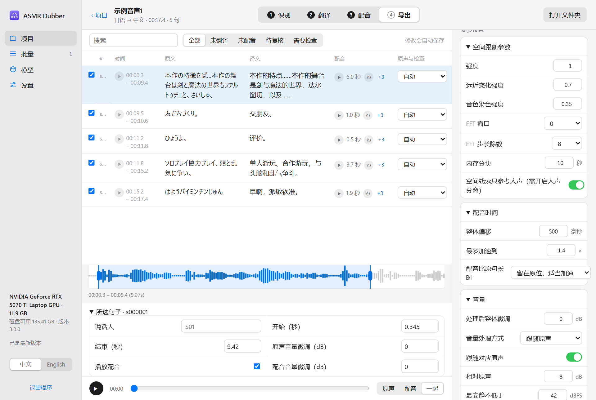
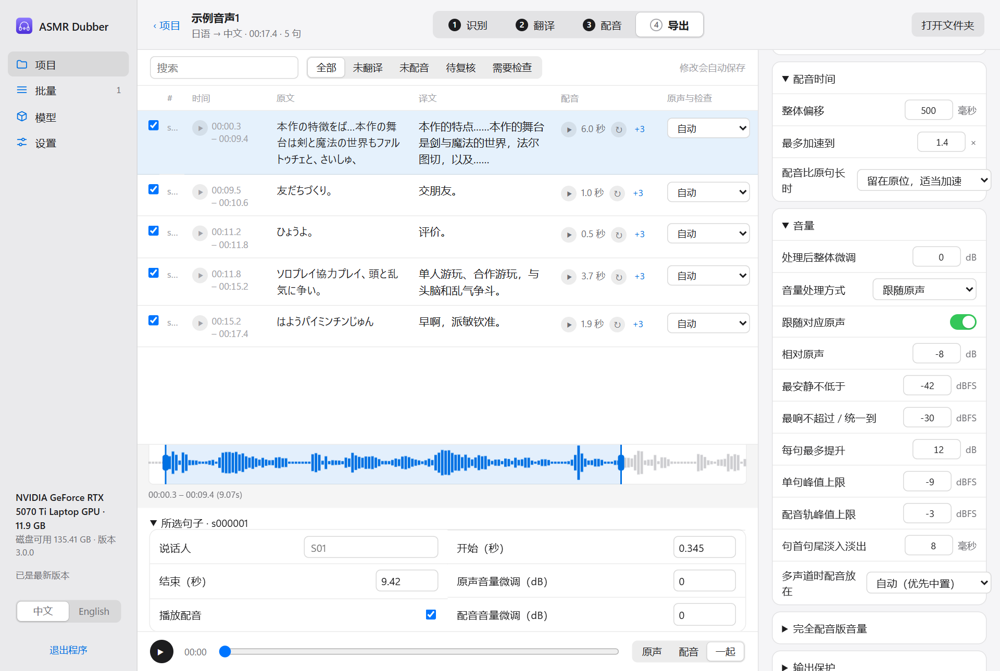
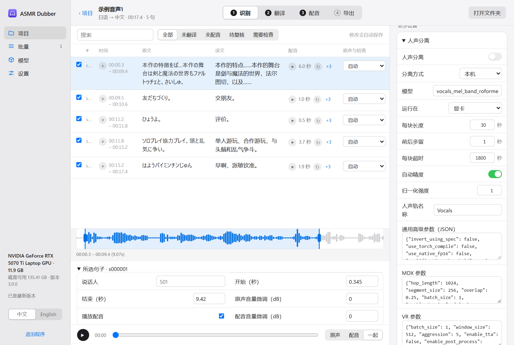

中文 | [English](en/EXPERIMENTAL_AUDIO.md)

[← 全部文档](INDEX.md)

# 混音与空间跟随

配音生成好之后，怎么把它和原声合到一起，都在“导出”这一步里调。这里的设置改了以后只需要重新导出，不用重新配音，所以可以放心反复试。

## 四种成品

| 成品 | 里面有什么 | 适合 |
|---|---|---|
| 双语版 | 完整的原声 + 配音 | 大多数情况。原声一点不少，中文叠在上面 |
| 完全配音版（实验性） | 有配音的句子换成配音，其余保持原声 | 不想听到原来的语言 |
| 只有配音轨 | 只有配音，没有原声和背景 | 想在别的软件里自己混音 |
| 只要字幕 | 没有音频 | 只想要翻译字幕 |

前两种在“成品”里选。配音轨通过“保存哪些音频”一并保存。只要字幕在“导出内容”里选。

## 空间跟随

音声里的声音经常是会动的：从左耳到右耳，从远到近。普通的配音只会待在正中间，听起来和原声是脱节的。

打开“空间跟随”后，程序会分析每句原声的左右位置和远近，让对应的中文配音出现在同样的位置。这个功能在界面和旧文档里也叫 RTF（原声空间线索迁移）。

一般只要打开开关就行。觉得效果不对时，展开“空间跟随参数”：

| 参数 | 作用 | 怎么调 |
|---|---|---|
| 强度 | 整体效果的强弱。0 是不处理，1 是完全跟随 | 觉得位置变化太夸张就调低 |
| 远近变化强度 | 配音跟着原声变近变远的程度 | 配音忽大忽小时调低 |
| 音色染色强度 | 配音带上多少原声的音色特征 | 配音听起来发闷或变味时调低 |
| FFT 窗口、FFT 步长除数 | 分析的精细程度 | 一般不用动 |
| 内存分块 | 一次处理多长的音频 | 内存不够时调小 |

有两个限制：

- **原声必须是双声道的。** 单声道的音频没有位置信息，开了也没用。
- 某一句原声太短或太安静，分析不出位置时，这一句会放在比较居中的位置。日志里会写“RTF 降级”，这不是出错。

## 配音的时间

展开“配音时间”：

**整体偏移**：配音比原句晚多久开始，单位是毫秒。默认 500，也就是原声说了半秒之后中文才进来，这样两个声音不会完全叠在一起。正数是往后推，负数是往前提。

**配音比原句长时**：中文经常比日语长，一句还没说完下一句就该开始了。有两种处理方式：

- **留在原位，适当加速**：每句都在原来的时间点开始，说不完就加快语速。加速有上限（“最多加速到”，默认 1.4 倍），到了上限还说不完，就会和下一句重叠一点。
- **上一句结束后再放下一句**：不加速，也不重叠，后面的句子往后顺延。配音会越来越晚于原声，成品也可能比原音频长。

大多数情况用第一种。如果发现很多句子被加速得太明显，更好的办法是回到翻译步骤把译文改短。

## 音量

展开“音量”。

**音量处理方式**有三种：

- **跟随原声**（默认）：原声这句轻，配音也轻；原声响，配音也响。最自然。
- **统一音量**：每句配音都调到一样响。原声的音量忽大忽小、导致配音跟着乱跳时用。
- **保留原始音量**：配音模型生成出来多响就多响。

觉得配音整体太响或太轻，改“相对原声”或“处理后整体微调”，单位是分贝，正数变响，负数变轻。

只想调某一句的音量，见[使用手册的“改某一句”](USER_GUIDE.md#8-改某一句)。

“输出保护”分组里是峰值限制，防止成品爆音，一般不用动。

## 完全配音版：去掉原来的人声

完全配音版把有配音的句子里的原声换成中文配音，其余时间的声音保持原样。界面里“成品”选项叫“完全配音版（实验性）”，批量页叫“完全配音”，是同一个东西。它仍然是实验性功能，下面先说它是怎么做的，再说限制。

### 3.0 的做法

1. **先识别、翻译、配音**，和双语版一样（完全配音预设默认优先推荐 IndexTTS-2.5，并在生成时直接控制每句目标时长 `tts_fit_source_duration`，大幅减少事后变速）。再用人声分离模型把原声拆成“人声”和“背景”。
2. **只在有配音的句子区间里去掉人声。** 区间是句子的起止时间，向外各取一小段，边缘吸附到人声最弱的位置，两端各做 30 毫秒淡化；两个区间间隔不到 150 毫秒会合并。区间之外，成品和原文件逐个采样点相同，呼吸、口腔声、音效和句间的环境声都原样保留。
3. **句尾跟随。** 识别给出的结束时间常常偏早，轻声的句尾会漏出来。区间会顺着分离出的人声继续往后延伸到这句话真正结束（最多 1.5 秒），往前最多 0.6 秒，都不会越过相邻的句子。
4. **补回底噪与残差抑制。** 分离模型会把房间噪声和麦克风底噪也归进“人声”，去掉以后区间里会变成绝对安静。程序按原录音的底噪补上缺的那部分，并可选按 `replacement_residual_suppression` 在人声主导频段做温和维纳抑制。
5. **双音色锚点与配音贴近原声。** 开启 `tts_dual_voice_anchor` 时，程序分别为正常发声和耳语挑选参考锚点；混音时配音按原句调整频谱与近讲低频（60–260 Hz），补全 11 kHz 以上高频（气声、齿音），原句是耳语时仅对谐波成分做气声化转换。空间跟随照常使用，只参考分离出的人声位置。
6. **配音的时间与变速。** 配音首尾静音先裁掉，再放到原句开始处；需要微调语速时用 FFmpeg `atempo` 变速、不变调（0.90× 放慢至 1.25× 加速）。盲听对比里它比内置的相位锁定声码器更干净，所以保留。配音比原句长时先在加速上限内压缩，放不下才顺延，下一句再追回。

### 默认值

新建的项目用这些默认值（旧项目保持它们原来的行为，已有配音不会因此变成“已过期”）：

| 设置 | 默认 | 作用 |
|---|---|---|
| 原人声去除范围 `replacement_scope` | 只去掉有配音的句子 | 另一个选项“去掉全部人声”是 1.0 的旧做法 |
| 配音偏移 `replacement_dubbing_offset_ms` | 0 毫秒 | 配音从原句起点开始。双语版的偏移是 500 毫秒，两者互不影响 |
| 配音比原句长时 `replacement_timing_mode` | 先适当加速，放不下再顺延 | |
| 最大自动加速 `replacement_max_auto_speed` | 1.25 倍 | 双语版是 1.4 倍 |
| 音色贴合强度 `replacement_voice_match_strength` | 0.85 | 0 为不处理 |
| 补全高频 `replacement_bandwidth_extension` | 开 | |
| 补回底噪 `replacement_noise_fill` | 开 | |
| 耳语转气声 `replacement_whisper_match` | 0.65 | 0 为关闭，仅针对有声谐波成分气声化 |
| 生成时贴合原句时长 `tts_fit_source_duration` | 开 | IndexTTS-2.5 / IndexTTS2 原生控制目标时长 |
| 耳语双锚点 `tts_dual_voice_anchor` | 开 | 耳语句自动切换项目内的耳语参考锚点 |
| 参考音频质量 `reference_audio_mode` | 16 kHz 单声道 | 全带宽参考会把原声里的气声和口水音带进 IndexTTS，盲听里出现破音，所以 3.0 改回 16 kHz；高频由“补全高频”补回。已有项目保留原设置，改了会让已有配音需要重做 |
| 配音前处理停顿 `tts_normalize_pauses` | 开 | 句中的省略号、连续破折号换成逗号，句首句尾的去掉，只影响送去配音的文字，表格里的译文不变 |
| 数字转中文读法 `tts_spoken_normalization` | 开 | 配音前将年份、百分比和数字展开为自然中文读音 |
| 自动检查配音 `tts_quality_check` | 开 | 见下文；另可开启 `tts_asr_quality_check` 用语音识别复听检查读音 |
| 翻译按时长预算 `translation_length_budget` | 开 | 大模型翻译时按原句时长限制每句长度，约每秒 4.5 个汉字 |

### 自动检查配音

每句配音生成后会检查：几乎没有声音、按字数算短得离谱（可能漏字）、长得离谱（可能有多余内容）、削波。不合格的会换一个随机种子重做，每次运行最多两轮，仍不合格的在句子表里标出“配音质检未通过”和原因。这只能抓住明显的失败，念错一两个字它发现不了。

### 在句子表里检查和修改

句子表里有三处和完全配音版有关：

- **原声处理**：每句三选一。“自动”按上面的规则（有配音就替换，没有就保留）；“保留原声”这一句不去掉原人声，也就不会听到配音；“替换掉原声”强制去掉这一句的原人声。
- **检查列**：配音质检没通过的句子标红，写着原因。导出过的项目里，被残留报告标出的句子标橙。
- **重新生成这一句配音**：配音列里的 ↻，用新的随机种子只重做这一句。

上方的“需要检查”筛选会只列出这两类句子。

### 残留原声报告

每次用“只去掉有配音的句子”范围导出完全配音版，会在项目的 `mix/replacement-report.json` 里写一份报告，对每个被替换的句子给出：

- `residual_db`：区间里“原文件减去分离人声”的能量，比分离人声的能量，单位 dB。数值越大说明替换之后剩下的声音越多。
- `uncovered_before_seconds`、`uncovered_after_seconds`：紧邻这个区间前后 2 秒内，分离人声有活动、却没有任何句子覆盖的时长。这通常意味着识别漏掉了一句话。

超过阈值的句子 `exceeds` 为真，并在句子表里标出来，旁边有“这一句改为保留原声”。阈值是经验值：残留比大于 −9 dB 且比其他被替换句子的中位数高 8 dB 以上，或者没有句子覆盖的人声活动达到 0.8 秒。这些数字是用几段素材试出来的，没有用标注数据校准。

**这份报告是能量估计，不是识别结果。** 程序没有对原声再做一次日语识别，所以它不知道残留的是不是话，也可能是人声分离模型留下的音效。它只告诉你哪里值得听一听。

### 成品对比播放器

导出之后，“导出”步骤里的“成品对比”可以同步播放原声、双语版和完全配音版（项目里有哪个就显示哪个），一键切换时保持播放位置。勾选“循环所选句子”会反复播放句子表里选中的那一句，方便逐句检查。

### 限制

- **识别不出来的话，原声就留着。** 识别没有给出句子的地方不会有配音，也不会去掉原声。极轻的耳语最容易漏。残留报告里的“没有句子覆盖的人声”可以帮你找到它们，之后手动补一句，或换识别模型重新识别。
- **耳语转气声是信号处理的模拟。** 它保留配音的共振峰，把声带振动换成噪声激励，效果是“像在耳语”，不是真的耳语录音，听感上仍可能比原声更“干”。
- **没有混响匹配。** 配音不会带上原录音的房间感，也不模拟距离和近讲效应；空间跟随只迁移左右位置和远近，不是房间声。
- **拟声词、喘息、亲吻声故意保留原声。** 切句时，0.4 秒以上的拟声、喘息和亲吻声会被单独切成一句，翻译跳过它们，原声保留。它们没有对应的中文，所以不配音。
- 分离不可能完全干净，被替换的区间里仍可能留下一点原声的痕迹；分离也慢。
- 配音经过加速、频谱调整和气声转换，音质不会和原录音完全一样。

### 做一个完全配音版

**1. 下载人声分离模型。** 在“模型”页的“可选”分组里。

**2. 在项目里打开人声分离。** 到“识别”步骤，展开“更多设置”里的“人声分离”，打开开关。

**3. 导出时选完全配音版。** 到“导出”步骤，“成品”选“完全配音版（实验性）”，点“导出”。第一次会先做分离，需要等一阵。

### 保留某些原声

没有配音的句子本来就保留原声，不需要额外设置。想要某一句保留原声（比如它被翻错了），把句子表里的“原声处理”改成“保留原声”。

“原声回填”（没有配音的句子、手动指定、不回填）只在“原人声去除范围”选了“去掉全部人声”时才起作用，那是 1.0 的做法。

### 用云端做分离

没有显卡的话，分离可以交给云端服务（Replicate 或自己搭的接口）。在“人声分离”里把“分离方式”改成 Replicate 或自建接口，并在“设置 → 云端服务”填好 Key。这会把音频上传到那个服务，并且可能产生费用。

## 要不要重新配音

| 改了什么 | 需要重做 |
|---|---|
| 空间跟随、配音时间、音量、输出保护 | 只需要重新导出 |
| 双语版换成完全配音版 | 重新导出（第一次要等分离） |
| 句子表里的“原声处理”、“这一句改为保留原声” | 只需要重新导出 |
| 参考音频质量、停顿处理、配音质检、译文 | 要重新生成相关句子的配音 |
| 打开或关闭人声分离 | 建议重新识别，因为识别用的音频变了 |
