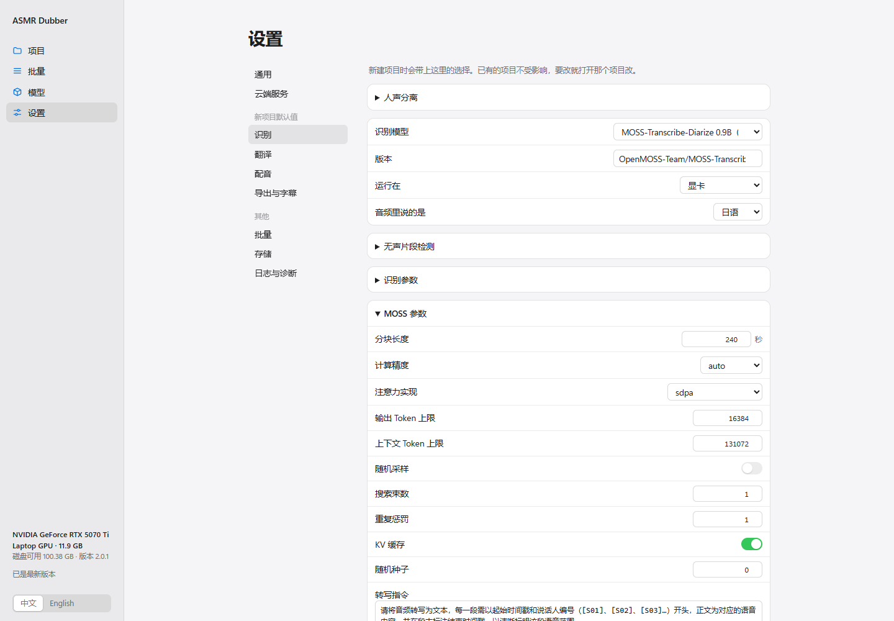
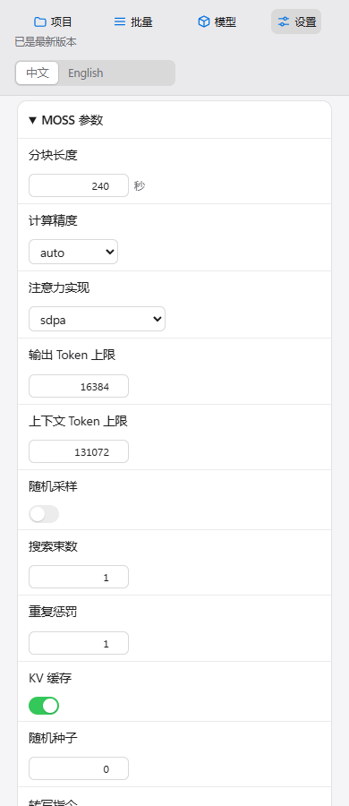
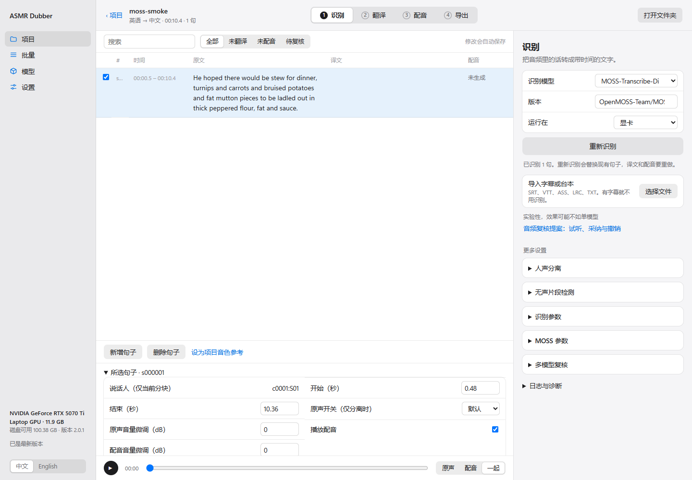

中文 | [English](en/MOSS_VALIDATION_2026-10-16.md)

# MOSS 验证报告 · 2026-10-16

## 实现与环境

- 新增独立 MOSS 后端、17 项参数、说话人标签保存/显示、模型安装/删除和运行环境诊断。
- Windows，RTX 5070 Ti Laptop 12 GB，Torch 2.11.0+cu130，Transformers 5.6.0，BF16，SDPA。
- UI：`http://127.0.0.1:7867/`，1440×1000 与 390×900，使用独立临时配置目录。
- Browser plugin not available；使用项目现有 Playwright 测试方式及已安装 Edge，无新增浏览器依赖。
- 改动前已有未提交的参数表、翻译、表单与设计文件，保留原修改；本次没有提交或推送 Git。

## 检查

| 检查 | 结果 | 证据 |
|---|---|---|
| 页面身份、非空页、无错误遮罩 | 通过 | 页面标题 ASMR Dubber，模型与设置页面均渲染。 |
| 页面与控制台错误 | 通过 | Playwright 收集的 pageerror/console error 列表为空。 |
| MOSS 参数条件显示 | 通过 | 选择 MOSS 后显示；关闭采样隐藏采样参数；切换 Faster-Whisper 后隐藏 MOSS 组。 |
| 自动保存与重载 | 通过 | 分块 300 改为 240 秒，刷新后仍为 240；仅修改临时 QA 设置。 |
| 桌面与窄屏 | 通过 | 无横向溢出；扩大 MOSS 数字输入框后六位上下文预算完整可见。 |
| 说话人保存/显示 | 通过 | 实际 GPU 结果保存为项目，重新打开后显示 `c0001:S01`。 |
| 10.435 秒公开英语语音 | 通过 | 原生适配器成功返回完整文字、起止时间和说话人。 |
| 320.18 秒分块输入 | 通过 | 56 段、两块、90.11 秒；第二块使用独立说话人命名空间，末段结束于 318.87 秒。 |
| 下载/解析/取消/状态/删除回归 | 通过 | `tests/test_moss.py`：10 项。含镜像优先、断点续传、校验损坏回退、全失败不发布、取消保留临时文件、解析异常、项目语言兼容与模型删除。 |
| ModelScope 发布 | 通过 | 在现有仓库提交 19 个文件，无删除。包含模型文件、许可证和镜像清单。 |
| 匿名镜像完整下载 | 通过 | 18 个运行文件逐字节 SHA-256 与固定清单一致；不是仅检查 HEAD 或文件大小。 |
| Ruff | 通过 | `ruff check src/asmr_dubber tests/test_moss.py`。 |
| ModelScope artifact 合同 | 通过 | `scripts/verify_modelscope_artifacts.py`。 |

全套离线回归：**712 passed, 3 skipped, 1 deselected，32.79 秒**。命令为 `pytest -m "not network and not gpu and not slow"`；另执行了前述真实 GPU 推理与匿名镜像网络下载验证。详细日志位于开发目录 `.asmr-dubber/temp/moss-pytest-final.log`。

## 操作与代码

测试流程：模型页看到 MOSS → 设置/识别选择 MOSS → 展开 MOSS 参数 → 修改分块 → 刷新核对 → 开启采样核对额外控制 → 切换模型核对隐藏。另打开实际识别结果项目、选择句子、展开详细信息验证说话人。

主要实现：`moss.py`（下载与环境）、`moss_worker.py`（独立推理）、`moss_manifest.json`（固定文件清单）、`asr.py`（任务与时间轴）、参数目录、模型注册表与模型服务。

没有给出日语 ASMR 准确率、真实多说话人区分率、Linux/CPU 可用性的验证结论。320 秒输入由同一公开语音重复构造，只验证分块执行与时间轴。没有完成跨块说话人合并或自动多音色配音。

## 截图

240 秒是保存测试的自定义值，实际 schema 默认仍为 300 秒。

