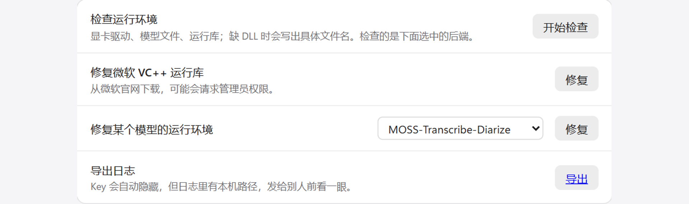

中文 | [English](en/TROUBLESHOOTING.md)

[← 全部文档](INDEX.md)

# 常见问题

## 先做这两件事

**1. 看报错写了什么。** 任务失败时，右侧任务框里会显示错误码（例如 `API_KEY_MISSING`、`TRANSLATION_RATE_LIMIT`、`CUDA_OOM`、`RUNTIME_MISSING`）、原因和解决提示，展开“日志”能看到更多细节。提交 Issue 时可在“设置 → 日志与诊断”或“批量”页导出自动脱敏的日志/诊断包。

**2. 跑一次环境检查。** 打开“设置 → 日志与诊断”，点“开始检查”。

它会检查显卡驱动、模型文件和运行库。哪一项有问题，就点对应的“修复”。

不管遇到什么问题，**都不要删除 `.asmr-dubber` 文件夹**。你的项目和模型都在里面。

## 启动

**双击 EXE 没反应，或者一闪就没了**

- 确认是解压后运行的，不是在压缩包里直接双击。
- 把程序放到路径短的位置，比如 `D:\ASMR-Dubber`。不要放在带中文和空格的很深的文件夹里。
- 看看是不是被杀毒软件拦了。

**黑色窗口出来了，但浏览器没打开**

手动打开 `http://127.0.0.1:7860`。黑色窗口里也会打印这个地址。

**提示端口被占用**

通常是上一次的程序没有关干净。关掉之前的黑色窗口再试。

**启动特别慢**

第一次启动，或者更新、搬家之后的第一次启动需要准备运行环境，等几分钟。杀毒软件扫描大量小文件也会拖慢速度。

## 下载模型

**下载失败或者特别慢**

- 在模型页右上角换一个下载来源试试。
- 确认磁盘空间够。模型下载后还要解压，需要的空间比显示的大小多。
- 直接再点一次“下载”，已经下好的部分不会重下。

**下载完了，但显示“未安装”或“不完整”**

展开这个模型的“详情”看缺了什么。然后到“设置 → 日志与诊断”，在“修复某个模型的运行环境”里选它，点“修复”。

**报“文件存在但找不到”之类的错**

多半是路径太长。把程序搬到更短的路径，并打开 Windows 的长路径支持，见[安装与模型](INSTALLATION.md#1-下载并解压)。

**报 DLL、VC++ 相关的错**

在“日志与诊断”里点“修复微软 VC++ 运行库”。

## 识别

**显存不足（out of memory）**

- 关掉其他占显存的程序，比如游戏和别的 AI 软件。
- 在识别的“更多设置”里把批大小改成 1，把分块长度调小。
- 换小一点的模型，或者把“运行在”改成处理器。

**英语或中文的音频识别出来是乱的**

Parakeet 和 Kotoba 只能识别日语。新建项目时把“音频里说的是”选对，再用 Faster-Whisper。

**轻声说的话被漏掉了**

把“无声片段检测”关掉再识别一次。它会跳过很安静的片段，耳语容易被误伤。

**长静音里冒出莫名其妙的句子**

和上面相反，打开“无声片段检测”。日语音声可以用“ASMR 专用”的那个（需要先下载）。

**进度条很久不动**

模型加载阶段没有进度，属于正常。展开“日志”看看有没有新内容在输出。几分钟都没有任何新内容才算卡住。

## 翻译

**报 401、403、“Key 无效”**

Key 填错了，或者填到了别的服务下面。到“设置 → 云端服务”重新填。再确认项目里选的“翻译服务”就是你填了 Key 的那一家。

**报 404、“模型不存在”**

“模型”那一栏的名字不对。到服务商的后台看看你的账号能用哪些模型，把准确的名字填进去。

**有些句子的译文是空的**

笑声、呼吸、“嗯”这类没有实际意思的句子不会被翻译，这是正常的。如果是有内容的句子空着，展开任务的日志看有没有报错，然后再点一次“翻译剩余”。

**长静音里出现“ご視聴ありがとうございました”这类句子**

这是语音模型在静音或噪声上编造的常见结尾语。识别后会自动停用这类句子（状态显示为幻觉），试听确认确实有人说了，再手动启用。

**翻译完成后有些句子被标出来**

翻译结束时会自检：译文里残留日文假名、比时长预算长 20% 以上、与原文完全相同、或与上一句译文重复（原文不同）的句子会被标出，只需重新翻译这些句子。

**翻译把我手动改的覆盖了**

“翻译剩余”不会动已有的译文。会覆盖的是“全部重新翻译”，点它之前有确认提示。

## 配音

**Edge TTS 报 403，或试听无法生成**

升级到 2.2.1 或更新版本，关闭程序并用新版启动器重新启动。旧的 edge-tts 7.2.8 不兼容 Microsoft 新版鉴权；启动器会检查并更新到兼容客户端（至少 7.3.1）。不需要 API Key，也无需重下语音模型。

如果新版仍报 403，请稍后重试或检查服务访问限制。429 表示限流，可降低配音并发；“未收到音频”可能是音色或服务临时异常，可换音色或只重试失败句。配音请求受“单句超时”限制，试听最多等待 30 秒；已成功的配音会保留。

**声音一点也不像原声**

- 确认用的是 IndexTTS2 这类克隆模型。Edge TTS 是固定音色，不会像。
- 换一个音色参考。参考太短、背景太吵、不止一个人说话，都会让音色跑偏。见[使用手册](USER_GUIDE.md#选音色参考)。

**只改了一句，却要重新生成很多句**

改译文只会影响那一句。如果很多句都要重做，说明你还改了别的：配音模型、音色参考，或者配音的参数。这些一变，之前的配音就都不算数了。

**第一句等了很久才开始**

第一次要先把模型加载到显卡里，需要一些时间。后面的句子会快很多。

**点了暂停，但没有马上停**

正在生成的那一句要做完才能停。云端服务的请求已经发出去的话，也要等它返回。

## 导出

**配音和原声叠在一起，听不清**

到导出步骤展开“配音时间”，把“整体偏移”调大，让配音更晚进来。

**配音语速忽快忽慢**

中文比原句长的时候，程序会自动加速。把译文改短是最好的办法。也可以把“最多加速到”调低，或者把“配音比原句长时”改成顺延。

**配音太响或太轻**

展开“音量”，调“相对原声”。

**打开空间跟随后报声道错误**

空间跟随要求原声是双声道。单声道的音频请关掉它。

**导出提示某一句“没有中文”**

这一句有原文但没有译文。补上译文，或者去掉这一句左边的勾，再导出。

**完全配音版里还能听到原来的声音**

最常见的原因是识别没有听出那一句，没有句子就不会被替换。先在句子表选“需要检查”，看有没有被标出的句子，也可以对照项目里 `mix/replacement-report.json` 的“没有句子覆盖的人声”。其次是人声分离做不到完全干净。想让某一句保留原声，把它的“原声处理”改成“保留原声”。详见[完全配音版](EXPERIMENTAL_AUDIO.md#完全配音版去掉原来的人声)。

## 设置

**改了设置但没生效**

多半是改错了地方。“设置 → 新项目默认值”只影响以后新建的项目。想改现在这个项目，要在项目里改。见[设置与存储](CONFIGURATION.md#设置在哪里改)。

批量也一样：已经在队列里的作品不会跟着默认值变，要点“编辑”再保存。

**界面切成 English 了，配音还是中文**

界面语言和配音语言是两回事。配音语言在配音步骤的“配音成”里选。

## 批量

**开始时提示“开始前检查未通过”**

程序在处理任何文件之前检查了磁盘空间、显存、翻译 Key（会发一个最小请求）和所需模型。对话框里每一项写明了原因：空间不足就清理磁盘或换输出位置，Key 不通就到“设置 → 云端服务”检查 Key、额度和网络，模型缺失就到“设备与模型”页安装。

**队列里显示黄色的“部分完成”**

作品做完了，但有几句翻译或配音失败（没超过允许的数量，默认 3 句或 2%）。点开可以看到具体句子：没译文的只有原文字幕，没配音的保留原声。要补上就打开项目重做缺的句子。数量上限在“设置 → 批量”里改。

**作品失败，原因写着“超过批量允许的 N 句”**

失败的句子多于允许的数量，说明服务或设置有系统性问题，不是个别句子。看列出的原因，修好后点“继续”。

**怎么把批量的问题发给别人**

失败或部分完成的作品旁点“导出诊断包”，把 zip 附在 Issue 里。里面有日志、这个作品自己的日志、设置（不含 Key）、失败句列表和环境检查，没有 `secrets.json`。

## 还是解决不了

到“设置 → 日志与诊断”点“导出”，把日志文件附在 [Issue](https://github.com/EveningStudy/asmr-dubber/issues) 里，并写上：

- 你做了什么操作，在哪一步出的错
- 显卡型号和显存大小
- 用的是哪个识别模型和配音模型

日志里的 API Key 会被自动隐藏，但文件路径和作品名还在。发之前自己看一眼。
