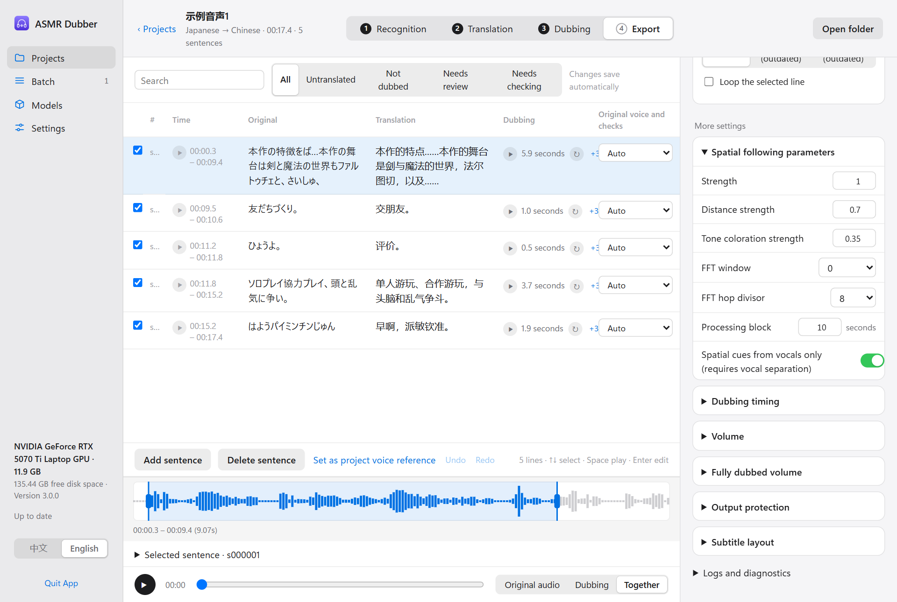
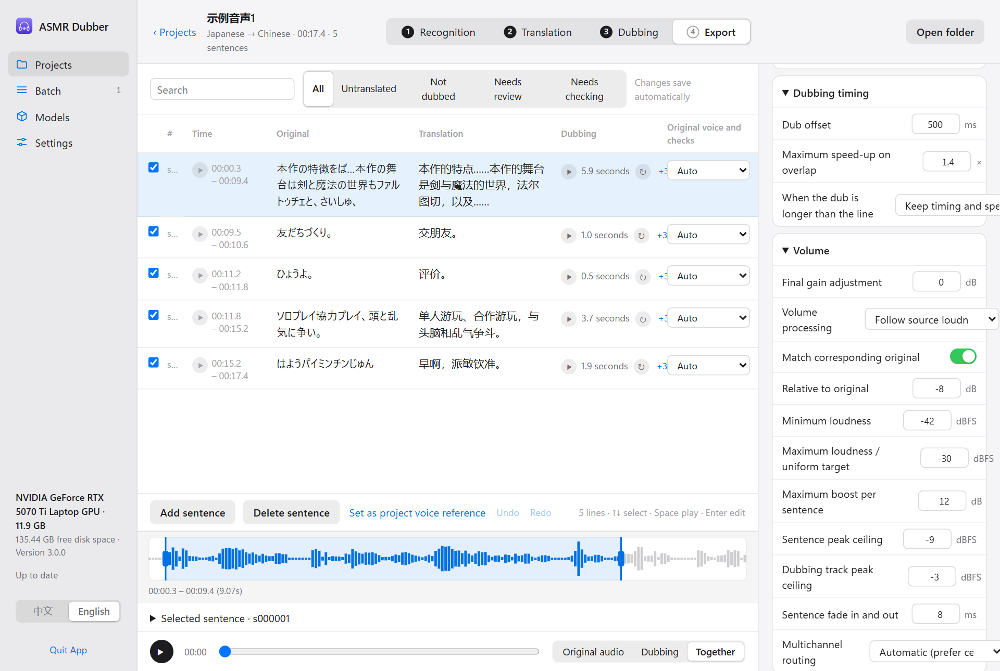
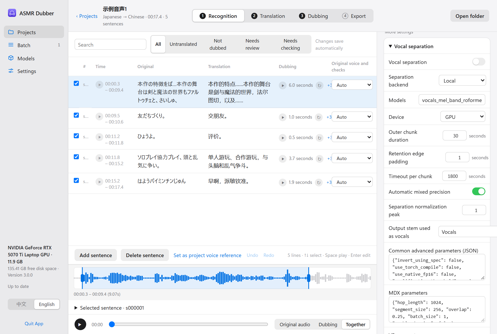

English | [中文](../EXPERIMENTAL_AUDIO.md)

[← All docs](INDEX.md)

# Mixing and spatial following

Once the dub exists, everything about combining it with the original is set on the **Export** step. Changing these settings only requires exporting again, never dubbing again, so feel free to experiment.

## Four kinds of result

| Result | Contains | Good for |
|---|---|---|
| Bilingual mix | The complete original plus the dub | Most cases. Nothing of the original is lost and the dub sits on top |
| Fully dubbed mix (experimental; called Replacement mix in the interface) | Dubbed sentences replaced by the dub, everything else as recorded | When you do not want to hear the original language |
| Dub track only | Only the dub, no original and no background | Mixing it yourself in other software |
| Subtitles only | No audio | When you just want translated subtitles |

The first two are chosen under **Mix mode**. The dub track is saved through **Audio output layout**. Subtitles only is chosen under **Output**.

## Spatial following

In these works the voice often moves: from the left ear to the right, from far to near. An ordinary dub sits in the centre and sounds detached from the original.

With spatial following on, the program analyses the left-right position and distance of each original line and places the matching dub line in the same spot. Older versions and some documents call this RTF (original spatial cue transfer).

Turning the switch on is usually enough. If it sounds wrong, expand **Spatial following parameters**:

| Parameter | What it does | How to adjust |
|---|---|---|
| Strength | Overall strength. 0 is off, 1 follows fully | Lower it if the movement is exaggerated |
| Distance strength | How much the dub gets nearer and farther with the original | Lower it if the dub volume jumps around |
| Tone coloration strength | How much of the original's tone colours the dub | Lower it if the dub sounds muffled or off |
| FFT window, FFT hop divisor | How fine the analysis is | Normally leave alone |
| Processing block | How much audio is processed at once | Lower it if you run out of memory |

Two limits:

- **The original must be stereo.** Mono audio carries no position, so the switch does nothing useful.
- If an original line is too short or too quiet to analyse, that line is placed near the centre. The log says "RTF downgraded". This is not an error.

## Dub timing

Expand **Dubbing timing**:

**Dub offset (ms)**: how long after the original line the dub starts. The default is 500, so the dub comes in half a second after the original starts and the two voices do not land exactly on top of each other. Positive delays the dub, negative brings it forward.

**When the dub is longer than the line**: a translation is often longer than the original line, so the next line is due before this one finishes. There are two ways to handle it:

- **Keep timing and speed up if needed**: each line starts at its original time and speaks faster if it would not fit. The speed-up is capped (**Maximum speed-up on overlap**, 1.4× by default). Past the cap, the line overlaps the next one slightly.
- **Play the next line after the previous one ends**: no speed-up and no overlap. Later lines are pushed back, so the dub drifts further behind the original and the result can be longer than the source.

The first mode suits most cases. If many lines are sped up noticeably, the better fix is to go back to the translation step and shorten the translations.

## Volume

Expand **Volume**.

**Volume processing** has three modes:

- **Follow source loudness** (default): a quiet original line gets a quiet dub, a loud one a loud dub. This sounds the most natural.
- **Uniform volume**: every dub line is brought to the same level. Use it when the original's volume swings wildly and drags the dub with it.
- **Keep original volume**: the dub stays as loud as the model produced it.

If the dub is too loud or too quiet overall, change **Relative to original** or **Final gain adjustment**. The unit is decibels: positive is louder, negative quieter.

To change the volume of one sentence only, see [Changing a single sentence](USER_GUIDE.md#8-changing-a-single-sentence).

**Output protection** holds the peak limiter that prevents clipping. You rarely need to touch it.

## Fully dubbed mix: removing the original voice

The fully dubbed mix replaces the original voice with the dub in every dubbed sentence and leaves the rest of the sound exactly as recorded. On the **Mix mode** choice the interface calls it **Replacement mix (experimental)**; the batch page calls it **Fully dubbed**. It is the same thing, and it is still experimental. What follows first describes how it works, then its limits.

### How version 2.0 works

1. **Recognise, translate and dub first**, as for the bilingual mix. A vocal separation model then splits the original into voice and background.
2. **The voice is removed only inside dubbed sentences.** A span is the sentence start and end with a little room on each side. Its edges snap to the quietest point of the separated voice and fade over 30 ms, and spans less than 150 ms apart are merged. Outside the spans the result is identical, sample for sample, to the original file, so breaths, mouth sounds, effects and the room between sentences stay as recorded.
3. **Following the end of the line.** Recognition often ends a line too early, and a soft tail would leak through. The span follows the separated voice until the line really ends (at most 1.5 s later) and back to its real start (at most 0.6 s earlier), never crossing a neighbouring sentence.
4. **The noise floor is refilled.** Separation files room and microphone noise under "voice", so a span would otherwise drop to digital silence. The program adds back the missing part of the recording's own noise floor.
5. **The dub is moved towards the original.** Its spectral shape is matched to the original line (strength in the table below), the highs above 11 kHz that dubbing models drop (breath, sibilance) are restored, and where the original whispers the dub is turned breathy. Spatial following works as usual and looks only at where the separated voice sits, so an effect in the other ear cannot mislead it.
6. **Timing.** Silence at the start and end of each dub is trimmed first, then the dub is placed at the start of the original line. A dub longer than its line is first sped up within the cap, and only pushed later if it still does not fit; the next line then speeds up to catch up. One long line therefore neither delays everything after it nor overlaps it.

### Defaults

New projects use these defaults (older projects keep their old behaviour, so existing dubs do not become "out of date"):

| Setting | Default | What it does |
|---|---|---|
| Original-vocal removal scope `replacement_scope` | Only dubbed sentences | The other option, removing all vocals, is the old 1.0 behaviour |
| Dub offset `replacement_dubbing_offset_ms` | 0 ms | The dub starts at the start of the original line. The bilingual mix uses 500 ms; the two do not affect each other |
| When a dub is longer than its line `replacement_timing_mode` | Speed up first, then shift | |
| Maximum auto speed-up `replacement_max_auto_speed` | 1.2× | The bilingual mix uses 1.4× |
| Timbre matching `replacement_voice_match_strength` | 0.8 | 0 is off |
| Restore highs `replacement_bandwidth_extension` | On | |
| Refill noise floor `replacement_noise_fill` | On | |
| Whisper to breath `replacement_whisper_match` | 1.0 | 0 is off. Experimental |
| Reference audio quality `reference_audio_mode` | Full band | The voice-cloning reference is no longer reduced to 16 kHz. Older projects use "legacy"; changing it makes existing dubs need regenerating |
| Pause handling before dubbing `tts_normalize_pauses` | On | Ellipses and repeated dashes inside a line become commas, and those at the start or end are removed. Only the text sent to the dubbing model changes; the translation in the table does not |
| Automatic dub check `tts_quality_check` | On | See below |
| Translate to a duration budget `translation_length_budget` | On | With a large language model each line is limited to what its time slot allows, about 4.5 Chinese characters per second |

### Automatic dub check

After each line is dubbed it is checked for: almost no sound, far too short for its text (words may be missing), far too long (extra content), and clipping. A line that fails is made again with a different random seed, at most two extra rounds per run. A line that still fails is marked **Dub check failed** with the reason in the sentence table. The check only catches gross failures; it cannot tell that one or two words were mispronounced.

### Checking and changing lines in the sentence table

Three things in the sentence table relate to the fully dubbed mix:

- **Original voice**: three choices per sentence. **Auto** follows the rules above (replace if there is a dub, keep otherwise); **Keep original** leaves the original voice of that line in, so its dub is not heard; **Replace the original** forces the original voice of that line to be removed.
- **Check column**: lines that failed the dub check are red with the reason. In a project that has been exported, lines flagged by the leftover report are orange.
- **Regenerate this line's dub**: the ↻ in the dub column makes only that line again with a new random seed.

The **Needs checking** filter above the table lists exactly these two kinds of line.

### Leftover-voice report

Each time the fully dubbed mix is exported with the scope **Only dubbed sentences**, the project gets `mix/replacement-report.json`. For every replaced sentence it gives:

- `residual_db`: the energy of "original file minus separated voice" inside the span, relative to the energy of the separated voice, in dB. A larger number means more sound is left after the replacement.
- `uncovered_before_seconds`, `uncovered_after_seconds`: how long, within 2 s just before and after the span, the separated voice is active while no sentence covers it. This usually means recognition missed a line.

A sentence over the threshold has `exceeds` set, is flagged in the sentence table, and gets a **Keep the original for this line** button. The thresholds are rules of thumb: a residual above −9 dB that is also at least 8 dB above the median replaced sentence, or 0.8 s of voice activity that no sentence covers. They were chosen by trying a few recordings and have not been calibrated on labelled data.

**The report is an energy estimate, not a recognition result.** The program does not run recognition on the original again, so it cannot say whether what remains is speech; it may just as well be an effect the separator left behind. It only tells you where listening is worthwhile.

### Result comparison player

After exporting, **Compare results** on the Export step plays the original, the bilingual mix and the fully dubbed mix together (whichever exist for the project) and keeps the playing position when you switch. **Loop the selected line** repeats the line selected in the sentence table, for checking line by line.

### Limits

- **Speech that recognition misses keeps its original voice.** Where recognition produced no sentence there is no dub and the original voice is not removed. Very soft whispers are the most likely to be missed. The "voice no sentence covers" figure in the report helps find them; add a sentence by hand, or recognise again with another model.
- **Whisper conversion is a signal-processing simulation.** It keeps the formants of the dub and replaces the vocal-fold buzz with noise excitation. It sounds like whispering, but it is not a recorded whisper and may still sound drier than the original.
- **There is no reverb matching.** The dub does not take on the room of the original recording, and distance or close-mic effects are not simulated; spatial following transfers left-right position and distance level only, not room sound.
- **Onomatopoeia, breaths and kisses deliberately keep their original voice.** While splitting lines, runs of at least 0.4 s of such sounds become their own line, translation skips them, and the original stays. They have no Chinese counterpart, so they are not dubbed.
- Separation is never perfectly clean, so a replaced span may still carry a trace of the original, and separation is slow.
- The dub has been sped up, spectrally adjusted and made breathy, so it will not sound identical to the original recording.

### Making a fully dubbed mix

**1. Download a vocal separation model** from the Models page, in the **Optional** group.

**2. Turn on vocal separation in the project.** On the **Recognition** step, expand **Vocal separation** under **More settings** and turn on the switch.

**3. Choose the fully dubbed mix when exporting.** On the **Export** step, set **Mix mode** to **Replacement mix (experimental)** and click **Export**. The first export runs separation and takes a while.

### Keeping some of the original

Sentences without a dub keep their original voice already; nothing needs to be set. To keep the original of one particular line (for example because it was mistranslated), change **Original voice** to **Keep original** in the sentence table.

**Original vocal reinsertion** (undubbed sentences, manual selection, none) only has an effect when the scope is **Remove all vocals**, which is the old 1.0 behaviour.

### Separating in the cloud

Without a GPU, separation can be sent to a cloud service (Replicate, or an endpoint you host). Under **Vocal separation**, change **Separation backend** to Replicate or the self-hosted option, and enter the key under **Settings → Cloud services**. This uploads your audio to that service and may cost money.

## What needs redoing

| You changed | Redo |
|---|---|
| Spatial following, dub timing, volume, output protection | Export only |
| Bilingual mix to fully dubbed mix | Export only (the first time waits for separation) |
| **Original voice** in the sentence table, **Keep the original for this line** | Export only |
| Reference audio quality, pause handling, dub check, the translation | Regenerate the dub of the affected lines |
| Turned vocal separation on or off | Running recognition again is recommended, because the audio it listens to has changed |
