English | [中文](../USER_GUIDE.md)

[← All docs](INDEX.md)

# User guide

This guide takes one audio file all the way to a finished dub, using the most common case, Japanese into Chinese, as the example. English or Chinese originals, or dubbing into English, follow exactly the same steps; only the languages you pick and the recognition model differ.

Following it takes about twenty minutes, most of which is waiting for models to run.

Before you start, get the program running and download a recognition model and a dubbing model as described in [Installation and models](INSTALLATION.md).

**Contents**

1. [Before you start: add a translation key](#1-before-you-start-add-a-translation-key)
2. [Create a project](#2-create-a-project)
3. [The workspace](#3-the-workspace)
4. [Step one: Recognition](#4-step-one-recognition)
5. [Step two: Translation](#5-step-two-translation)
6. [Step three: Dubbing](#6-step-three-dubbing)
7. [Step four: Export](#7-step-four-export)
8. [Changing a single sentence](#8-changing-a-single-sentence)
9. [Stopping and picking up later](#9-stopping-and-picking-up-later)
10. [Where to go next](#10-where-to-go-next)

## 1. Before you start: add a translation key

Translation uses a large language model service, so you need an account and an API key with one of them. DeepSeek is the default: it is cheap and good enough.

Open **Settings → Cloud services** and click **Enter** next to the provider you use.

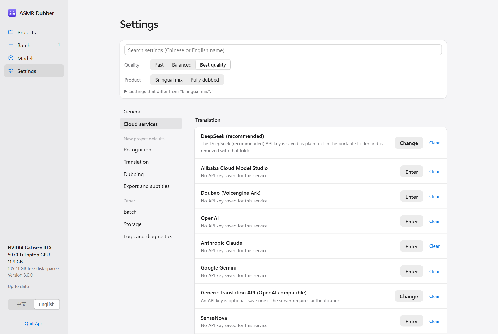

Paste the key and click **Save**.

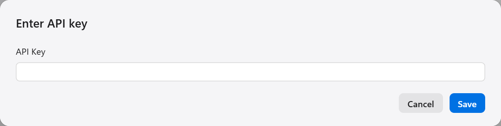

You can skip this step in two cases:

- You already have translated subtitles and do not need translation.
- The audio is already in the target language and you only want to re-voice it.

## 2. Create a project

Go to **Projects** and drop an audio or video file onto the **New** area, or click it to choose a file.

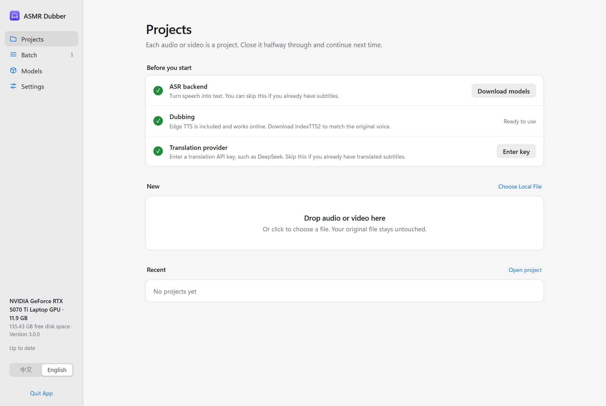

After the file uploads, this dialog appears:

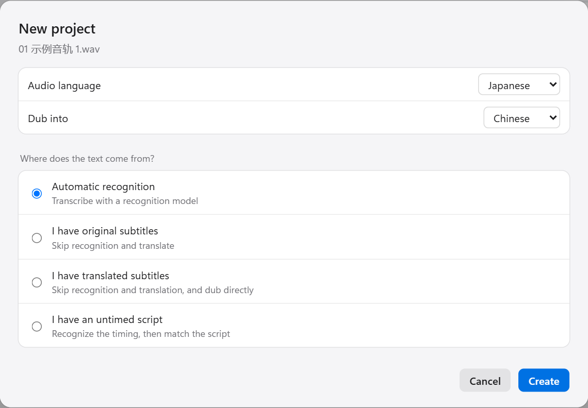

- **Audio language**: the language spoken in the original.
- **Dub into**: the language you want, Chinese or English.
- **Where does the text come from?**: choose **Automatic recognition** if you have no subtitles. If you have subtitles or a script, see [Subtitles and scripts](SUBTITLE_WORKFLOW.md).

Click **Create**. The program copies your file into the project folder. The original file is never modified.

## 3. The workspace

An open project looks like this:

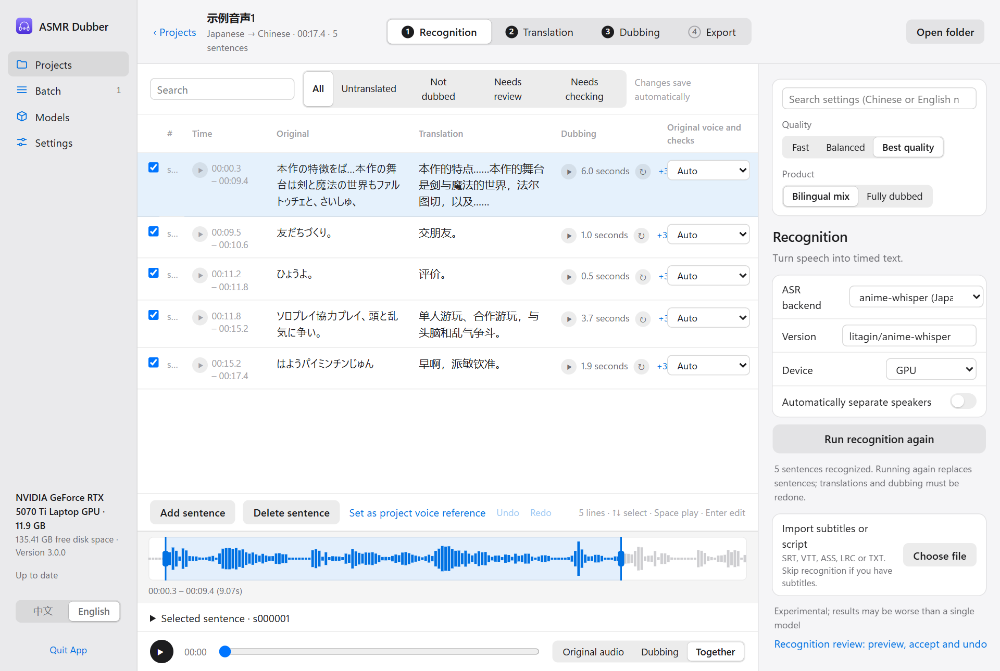

- **At the top** are the four steps: Recognition, Translation, Dubbing, Export. A finished step gets a filled number. You can click any step at any time to go back and change things.
- **On the left** is the sentence table. Each row is one sentence with its time, original text, translation and dubbing status. Click into the original or the translation to edit it.
- **On the right** are the settings and action buttons for the current step. The common ones are at the top and the rest are under **More settings**.
- **At the bottom** is the player. Switch between the original audio, the dub, or both together.

Settings changed in the right panel belong to this project only. They save automatically; there is no Save button.

## 4. Step one: Recognition

Recognition turns the speech into text with timing.

1. Check **ASR backend**. Use anime-whisper for Japanese (Parakeet until it is installed) and Faster-Whisper for English or Chinese.
2. Click **Run recognition again**. The button has this name even on the first run.
3. Wait. An hour of audio takes a few minutes on a GPU.

When it finishes, sentences appear in the table. Spend a few minutes reading the original text and fixing obvious mistakes. Translation works from this text, so an error here carries through every later step.

If sentences are split badly (one sentence cut in half, or two stuck together), expand **Segmentation** and **Silence detection** under **More settings**, adjust them, and run recognition again.

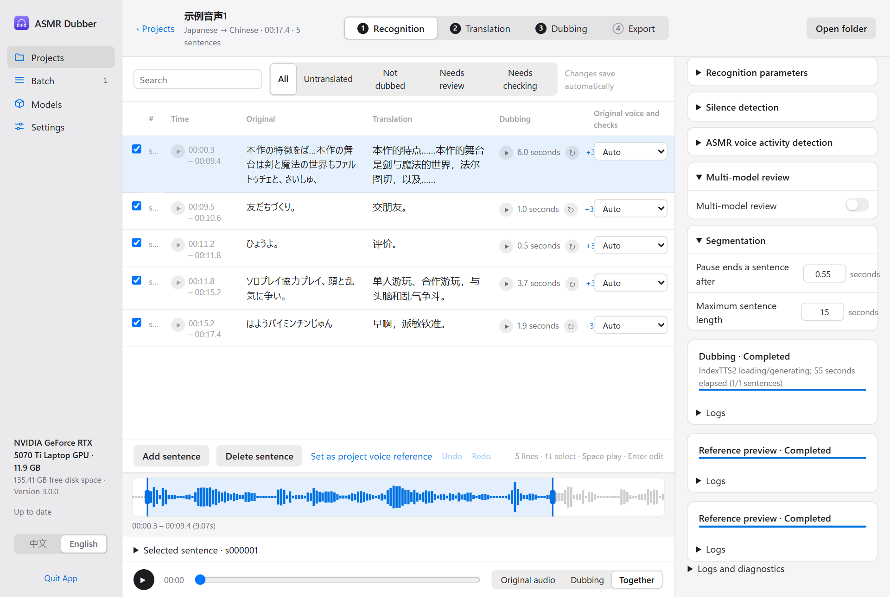

> **Note**: running recognition again replaces every existing sentence. Translations and dubbing already made have to be redone. Make sure the original text is right before moving on.

## 5. Step two: Translation

Click **Translation** at the top.

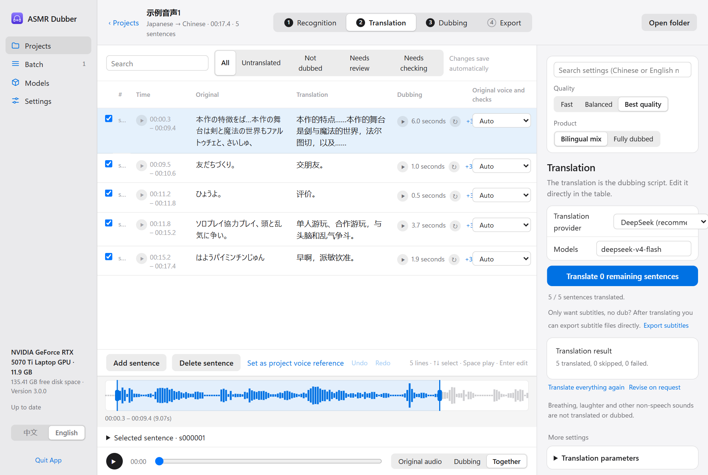

1. Check that **Translation provider** is the one you entered a key for.
2. Click **Translate N remaining sentences**.

The translations fill into the table. **The translation is the script the dub will read**, so it is worth reading carefully:

- If a line reads badly, click into the cell and rewrite it.
- A long translation makes a long dub, which may have to be sped up to fit. Try to keep each translation about as long as the original line.
- Laughter, breathing and other sounds with no real content are not translated. An empty translation there is normal.

**Translate remaining** only fills in sentences that have no translation and leaves your edits alone. **Translate everything again** retranslates every sentence, including the ones you edited by hand, and asks for confirmation first.

### Revise on request

When the translation is mostly right but one kind of problem keeps showing up (for example "do not use 'darling'", "make the tone softer", or "these lines sound too formal"), click **Revise on request** on the Translation page:

1. Choose the range: the selected sentence, the sentences matching the table's current search, or all translated sentences.
2. Write your request in **Your request**. Tick **Also include sentences I edited by hand** only if you want those revised too; by default sentences you edited yourself are left out.
3. Click **Start revising**. The program sends those sentences, their neighbours and your request to the translation model, which returns only the sentences that really need a change.

Nothing changes right away. When the run finishes, a **Revision proposals** list appears on the Translation page showing the source text, the old translation and the new translation for each sentence. Click the sentence number to find it in the table. **Accept** writes the new translation, **Reject** keeps the old one, and there are **Accept all** and **Reject all** buttons. An accepted sentence counts as edited by hand, and its dubbing has to be generated again. If the model suggests that a line should not be dubbed, accepting it follows your **Sound effects and nonverbal sounds** setting.

This needs a language-model translation service (DeepSeek, Bailian, OpenAI and so on). DeepL, Google Translate and Microsoft Translate translate sentence by sentence and are not supported. If you edit a sentence by hand after its proposal appeared, that proposal is discarded when you click **Accept**, so your edit is never overwritten.

To fit the translation to the work, expand **Translation parameters** and describe the characters, how they address each other, and the tone in **Translation prompt**. Context size and other parameters are here as well. **Restore built-in prompt** undoes your changes.

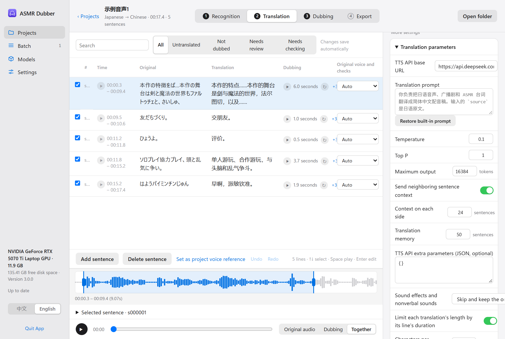

## 6. Step three: Dubbing

Click **Dubbing** at the top.

### Choose a dubbing model

- **IndexTTS2**: imitates the original voice. Needs an NVIDIA GPU. Use this when you want it to sound like the same person speaking another language.
- **Edge TTS**: Microsoft's online voices. Free, no GPU needed, but the voices are fixed and cannot imitate the original.
- For other cloud services, see [Models and services](BACKENDS.md).

### Choose a voice reference

A cloning model such as IndexTTS2 needs to know which voice to imitate. The program recommends a sentence automatically, and you can click **Change** to pick your own.

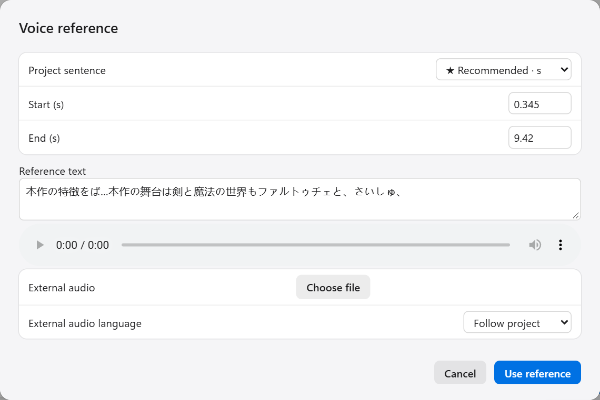

Pick a sentence under **Project sentence** and play it. A good reference is:

- 5 to 15 seconds long
- a single speaker
- normal speech, not pure breath or laughter
- over weak background music and effects

Entries marked ★ are the ones the program considers suitable. Entries marked ⚠ are too short. You can also click **Choose file** to use audio from outside the project. Click **Use reference** when done.

### Generate

Click **Generate N remaining sentences**. The program works through them one at a time and shows progress on the right.

A finished sentence gets a play button and a duration at the right edge of the table. Click it to hear that sentence.

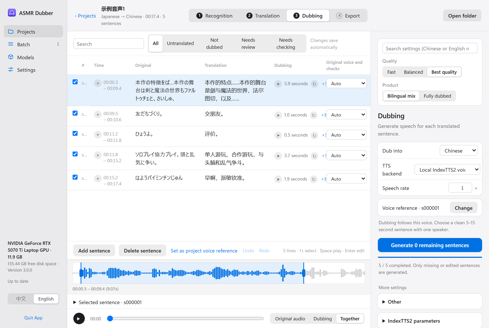

**Generate remaining** only generates sentences that have no dub yet and sentences whose translation changed. If you are unhappy with a line, edit its translation and click the button again. You never need to start over.

## 7. Step four: Export

Click **Export** at the top.

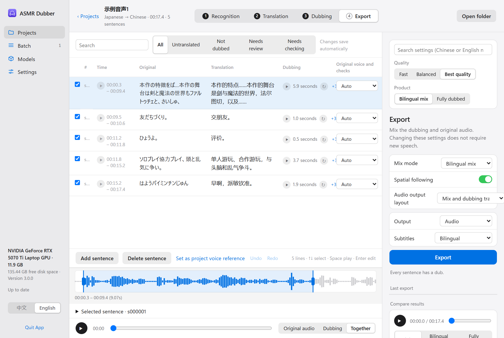

From top to bottom:

- **Mix mode**: **Bilingual mix** is the original plus the dub. **Replacement mix (experimental)** is the fully dubbed mix: the original voice is replaced by the dub in dubbed sentences and everything else stays as recorded. See [Mixing and spatial following](EXPERIMENTAL_AUDIO.md#fully-dubbed-mix-removing-the-original-voice).
- **Spatial following**: when on, the dub follows the left-right position and distance of the original voice. Recommended for stereo works.
- **Audio output layout**: besides the mix, you can save a separate track with only the dub, for further work in other software.
- **Output**: **Audio** exports normally. **Subtitles only** produces no audio.
- **Subtitles**: bilingual, translation only, original only, or none.

Click **Export**. The files appear under **Last export**, where you can listen to them right away or click **Download** to save a copy elsewhere.

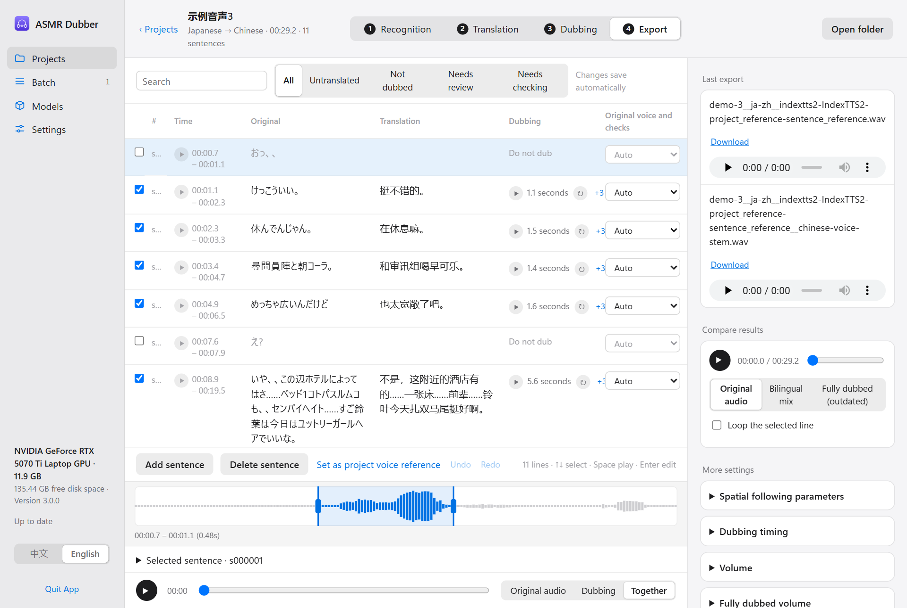

**Open folder** at the top right shows every exported file.

When you change the settings on this step (volume, dub timing, spatial following strength), you only need to click **Export** again. No dubbing is redone. See [Mixing and spatial following](EXPERIMENTAL_AUDIO.md) for those settings.

If export reports that a sentence has no translation, that sentence has original text but an empty translation. Fill it in, or untick the sentence, and export again.

## 8. Changing a single sentence

Click a row in the table to select it. Buttons appear below the table, and **Selected sentence** expands to show detailed controls for that sentence:

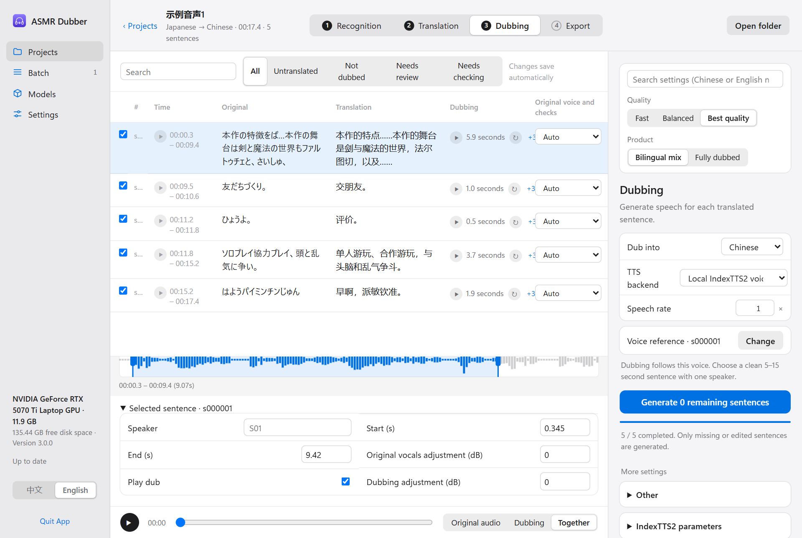

| To do this | Do this |
|---|---|
| Change the original or the translation | Click into the cell and edit. It saves when you click elsewhere |
| Leave this sentence undubbed | Untick the box at the far left of the row |
| Adjust when the sentence starts and ends | Change **Start (s)** and **End (s)** |
| Make this sentence's dub louder or quieter | Change **Dubbing adjustment (dB)**. Positive is louder, negative is quieter |
| Leave the dub out of the export but keep what was generated | Untick **Play dub** |
| Keep the original voice of a line in the fully dubbed mix, or force it out | Set **Original voice** in the table to **Keep original** or **Replace the original**; **Auto** replaces it when there is a dub |
| A dub came out wrong and you want another take | Click the ↻ in the dub column to redo only that line. The **Needs checking** filter lists lines that failed the check or may still carry the original voice |
| Add a sentence that was missed | Click **Add sentence** |
| Remove this sentence | Click **Delete sentence** |
| Use this sentence as the voice reference | Click **Set as project voice reference** |

Above the table you can search, or show only **Untranslated** or **Not dubbed** sentences to see what is left. Long projects show 50 sentences per page, with paging below the table.

What needs redoing after a change:

| You changed | Next |
|---|---|
| The translation of a sentence | Click **Generate remaining** on the dubbing step, then export |
| The dubbing model or the voice reference | Dub everything again, then export |
| Volume, dub timing, spatial following, subtitle layout | Export again |
| Ran recognition again | Translation and dubbing must both be redone |

## 9. Stopping and picking up later

- **To stop a running task**: click **Pause** next to the task on the right. What is already done is kept.
- **To continue**: click **Resume**, or click that step's button again. Only the rest is processed.
- **After closing and reopening the program**: the project is listed under **Recent** on the Projects page. Click it to return to where you were.

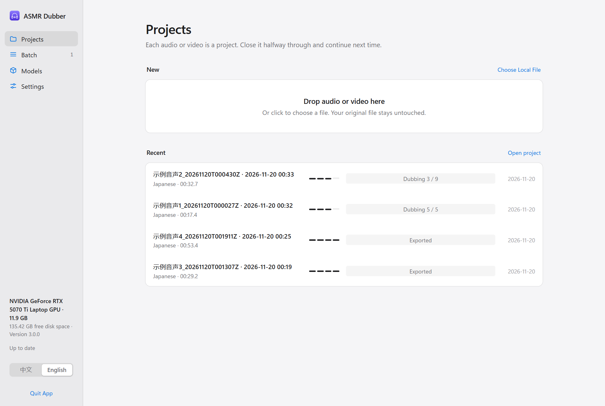

Closing the black window that appeared at startup stops the program. Closing the browser tab does not; open `http://127.0.0.1:7860` again to come back.

## First-run guide, presets and the task panel

- **First-run guide**: the first time the app opens, a three-step guide appears: detect the hardware and show a recommended setup, download the models (the same downloads as the Models page, pausable and resumable), and enter a translation key and press "Save and test". When it ends you land in "create a project". "Later" is remembered too, so it does not reappear; to run it again open Settings > General > First-run guide > Reopen.
- **Presets**: the project page (right side) and the top of Settings offer two groups. Quality: Fast / Balanced / Best quality. Fast is quicker and lighter on video memory (shorter separation chunks, less translation context, no dubbing quality check, fewer finishing steps in the full-dub version); Best quality is the shipped defaults. Product: Bilingual / Fully dubbed. Fully dubbed turns on vocal separation and needs the separation model installed first. Presets only change the settings they list and never switch the recognition or dubbing model. When your values differ from a preset, the differing settings are listed.
- **Settings search**: the box above the presets filters by Chinese name, English name or setting key; while searching, matches from every step and every settings page are listed together.
- **Global task panel**: the bottom-right corner of every page shows running tasks, their progress and an estimated time left, with a Pause button. Download tasks report progress per file, so they show no estimate.

## 10. Where to go next

- A whole work folder to process: [Batch processing](BATCH.md)
- You have subtitles or a script: [Subtitles and scripts](SUBTITLE_WORKFLOW.md)
- The dub and the original do not sit well together: [Mixing and spatial following](EXPERIMENTAL_AUDIO.md)
- Different models or services: [Models and services](BACKENDS.md)
- Something went wrong: [Troubleshooting](TROUBLESHOOTING.md)

## Missing translations and retry

Blank translations of meaningful speech are retried individually. Sentences that still fail stay enabled and never block the other batches: after every batch has run, the Translation panel shows a result card (translated, skipped and failed counts with the reasons). Click a sentence ID to find it in the table, then retry only the failed sentences or mark them as not dubbed. Only three consecutive failed batches, or key, billing and permission errors (HTTP 401/402/403), stop the run early, and finished translations are always saved. Interjections and short nonverbal sounds are flagged as `sound` by the model and handled by the Sound effects and nonverbal sounds setting: skip and keep the original (default), write romaji into subtitles only, or keep the source text in subtitles only. Translate all again replaces sentences one by one and keeps the old text until the new text arrives. A backup is written first and can be restored with Restore the previous translation; sentences you edited by hand are not overwritten unless you tick the option. Older incorrectly skipped speech can be restored together or enabled individually, updating row appearance and counts immediately. No inserted blank sentence or project reload is needed. Nonverbal laughter and breathing can still be skipped.
